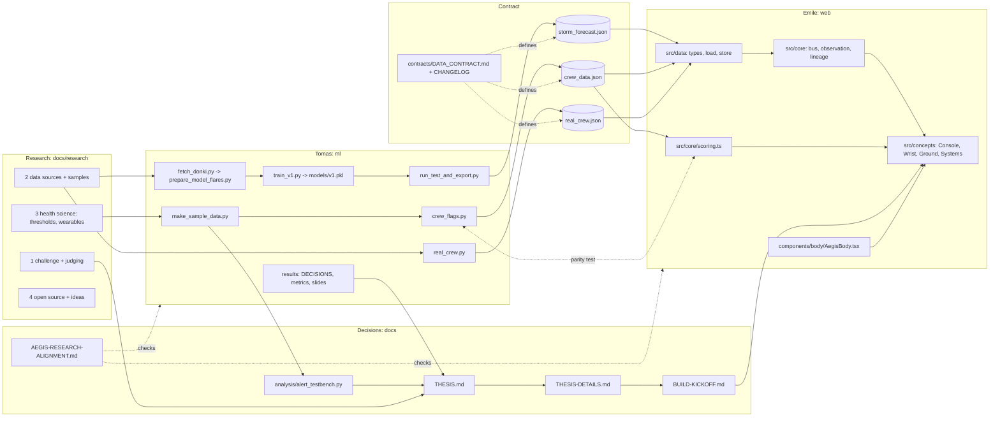

# e^x: project map

One place that shows how every part of the repo connects: research, decisions, Tomas's ML, the contract, the web app and the pitch. All paths are relative to the repo root.

## Summary
| | |
|---|---|
| Source of truth | This repo (`github.com/tmllo/aegis`, branch `main`). Nothing lives only on one laptop. |
| Owners | Tomas: `ml/`. Emile: `web/`. Both: `contracts/`, `docs/`. |
| The one interface | `contracts/DATA_CONTRACT.md`. The web app reads only `web/public/data/*.json`, written by `ml/`. |
| Safety nets | `python ml/validate_contracts.py` (shape) and `cd web && npm test` (web scoring = `ml/crew_flags.py`, golden test). Run both after any change to `ml/` or `contracts/`. |
| Later step | Live backend for the app (today the app is offline and reads the exported files). Every node below already names its file, so the backend can replace the files one edge at a time. |

## The network

The full data lineage (53 nodes, 74 edges, every edge with its source file) is `web/docs/lineage.json`, summary in `web/docs/lineage.md`. The Systems screen can draw it directly.

## Change ripple: if you touch X, check Y
| Change | Also update or re-run | Who |
|---|---|---|
| Shape of any JSON file | `contracts/DATA_CONTRACT.md` + `contracts/CHANGELOG.md` first, then `web/src/data/types.ts`, then `npm test` | Both, agreed first |
| Crew scoring rule (`ml/crew_flags.py`) | Same rule in `web/src/core/scoring.ts`; golden test in `web/src/core/scoring.test.ts`; testbench `docs/analysis/alert_testbench.py`; numbers in `docs/THESIS.md` section 2 | Tomas, then Emile |
| Simulated crew (`ml/make_sample_data.py`) | Re-export `crew_data.json`, `validate_contracts.py`, `npm test`; demo cards in `docs/THESIS.md` section 3 (Ana amber) | Tomas |
| Storm model or thresholds | `run_test_and_export.py`, `ml/results/DECISIONS.md`, `metrics.md`, slide PNGs; pitch numbers in `docs/THESIS.md` (16/17, 1 FA/month, 3.8 h) | Tomas |
| `real_crew.json` | Reference only: never scored, never merged with the simulated crew | Tomas |
| Body regions | Five contract regions (`brain`, `heart`, `blood`, `bones`, `whole_body`) = GLB node names in `web/public/models/aegis-body.glb`; rebuild with `docs/body-kit/build_aegis_body.py` | Emile |
| A pitch number | Must trace to a file in `ml/results/` or `docs/analysis/`. No number typed by hand. | Both |

## Where each question is answered
| Question | File |
|---|---|
| What are we building and why | `docs/THESIS.md` (short), `docs/THESIS-DETAILS.md` (long) |
| How the app is built | `docs/BUILD-KICKOFF.md`, `web/ARCHITECTURE-NOTES.md`, `web/docs/` |
| Why the storm model is v1 | `ml/results/DECISIONS.md`, `ml/results/scorecard_v1.md` |
| Why the 3-day mean rule | `docs/analysis/alert_testbench_results.json`, `contracts/CHANGELOG.md` (2026-11-15) |
| Is the repo consistent with the research | `docs/AEGIS-RESEARCH-ALIGNMENT.md` |
| Health thresholds and sources | `docs/research/3-health-science/03-health-indicators-thresholds.md` |
| Live NASA/NOAA feeds and offline copies | `docs/research/2-data-sources/01-realtime-data-apis.md`, `docs/research/samples/` |
| Judging and competitors | `docs/research/1-challenge-and-competition/` |
| UI look | `docs/design-references/`, `web/docs/design-brief.md` |

## Open points
| Point | Status |
|---|---|
| CBC study number: research says OSD-569, contract says OSD-575 | To confirm (Tomas) |
| Environment dose rates are hand-set working values | Known, stated in `web/docs/lineage.json` `meta.open_points` |
| Backend for live data | Later step; app stays offline for the demo |
