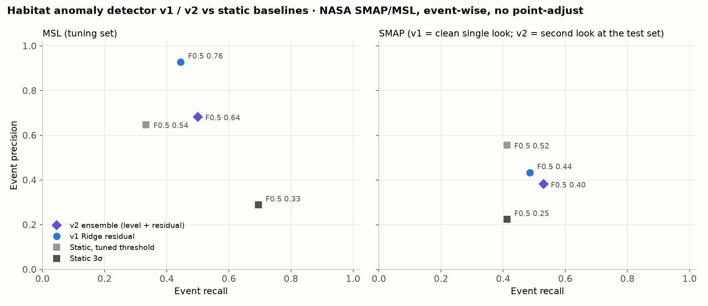

# Habitat anomaly detector: validation on NASA SMAP/MSL

Generated 2026-11-15T19:06:42Z by `python -m ml.anomaly.run_validation`. Runtime 41 s.

## Protocol
- Data: NASA JPL SMAP + MSL labeled telemetry anomalies (Hundman et al., KDD 2018). MSL 27 channels / 36 labeled anomalies; SMAP 54 channels / 68 labeled anomalies (the labels file lists SMAP channel P-2 twice with slightly different windows; we keep the first row, so 54/68, not 55/69).
- Every detector is fit on each channel's **train** split and scores the **test** split. Column 0 is the value; the forecasters also see the command flags at time t.
- **All hyperparameters and thresholds are tuned on MSL only** (grid below). The winner is the detector with the best event-wise F0.5 on MSL. Then **all detectors are scored once on SMAP** with their frozen MSL configs. No SMAP number was used to choose anything.
- Scoring is **event-wise, no point-adjust, early margin 0**: a labeled anomaly is caught if any predicted event overlaps it; each predicted event that overlaps no label is one false alarm. Counts are pooled over channels.
- Delay = steps from labeled start to the start of the first overlapping alarm (hits only). Bootstrap: 2000 resamples of SMAP channels.

## Results on SMAP (held out)

| detector | frozen config (from MSL) | precision | recall | F0.5 | false alarms / 10k steps | median delay (steps) | hits / labeled | false alarms |
|---|---|---|---|---|---|---|---|---|
| (a) Static 3σ on raw value | thr=3.0, min_dur=10, gap=50 | 0.22 | 0.41 | **0.25** | 5.16 | 16 | 28 / 68 | 225 |
| (a') Static, threshold tuned | thr=30, min_dur=1, gap=50 | 0.56 | 0.41 | **0.52** | 0.92 | 16 | 28 / 68 | 40 |
| (b) Ridge forecast-residual **(winner)** | L=60, span=30, thr=30, min_dur=10, gap=50 | 0.43 | 0.49 | **0.44** | 1.17 | 17 | 33 / 68 | 51 |
| (c) HistGradientBoosting forecast-residual | L=30, span=30, thr=30, min_dur=10, gap=0 | 0.27 | 0.65 | **0.31** | 5.25 | 18 | 44 / 68 | 229 |
| (d) IsolationForest on rolling windows | W=10, thr=8, min_dur=10, gap=0 | 0.77 | 0.15 | **0.42** | 1.19 | 12 | 10 / 68 | 52 |

## Same configs on MSL (tuning set; optimistic by construction, shown for transparency)

| detector | precision | recall | F0.5 | false alarms / 10k | configs searched |
|---|---|---|---|---|---|
| (a) Static 3σ on raw value | 0.29 | 0.69 | 0.33 | 8.68 | 9 |
| (a') Static, threshold tuned | 0.65 | 0.33 | 0.54 | 0.81 | 90 |
| (b) Ridge forecast-residual | 0.93 | 0.44 | 0.76 | 0.14 | 810 |
| (c) HistGradientBoosting forecast-residual | 0.59 | 0.64 | 0.60 | 4.20 | 360 |
| (d) IsolationForest on rolling windows | 0.66 | 0.31 | 0.53 | 2.98 | 270 |

## Verdict

- **Winner on MSL: (b) Ridge forecast-residual.** On SMAP it scores F0.5 = 0.44 (95% channel-bootstrap CI 0.29–0.74) vs 0.25 for the static 3σ baseline.
- Paired difference winner − static 3σ: 95% CI -0.04 to 0.49 (share of resamples where the winner is not better: 0.043).
- The winner scores higher than the static 3σ baseline on SMAP, but the paired bootstrap CI of the difference includes 0: the gain is not statistically clear on this data. Against the stronger tuned static baseline (F0.5 0.52) the winner is not better.
- Red threshold: 60.0 (no grid cutoff reached 80% precision on MSL; fell back to 2 x amber).

## Caveats (say these out loud)
- Wu & Keogh (2021) showed SMAP/MSL contains anomalies a one-line rule can find, and some doubtful labels. That is why we report against a trivial static baseline and use event-wise scoring without point-adjust. We do not claim state of the art.
- Pooled event counts weight long, alarm-heavy channels more. The bootstrap over channels shows how much the headline moves with the channel mix.
- These numbers are about the detector, not the habitat: the habitat stream in the app is simulated.
- Several MSL optima sit on the edge of the grid (threshold 30, merge gap 50, L 60, span 30). A wider grid might do better on MSL. We did **not** widen it and re-score SMAP afterwards, because that would turn the held-out set into a second tuning set. The grid was fixed before the first run.
- Precision counts predicted events, so a detector that fragments one anomaly into many short alarms gets many 'true alarms'. This is why IsolationForest shows high precision with low recall (many alarms on a few anomalies). Recall and false alarms per 10k steps are not affected by this.

## Grid (MSL only)
- Ridge: L ∈ {10, 30, 60}, EWMA span ∈ {5, 10, 30}, alpha = 1. HGB: L ∈ {10, 30}, span ∈ {5, 30}, 100 iterations, 15 leaves. IsolationForest: window ∈ {10, 30, 60}, 100 trees.
- Shared: threshold ∈ [2, 3, 4, 5, 6, 8, 10, 15, 20, 30], min duration ∈ [1, 3, 10], merge gap ∈ [0, 10, 50]. Static 3σ keeps threshold 3.0; its duration and gap are tuned. The tuned static row searches the threshold too.

## v2: level + residual ensemble (second look at SMAP)

**Why:** a one-step forecast-residual detector tracks slow drifts (the forecaster adapts, the residual stays small, and the EWMA span adds lag). It suits abrupt or contextual faults; a level rule suits slow drifts. v1 confirmed this on SMAP (a tuned static rule beat Ridge) and on the simulated habitat (the CO₂ ramp was flagged after the limit).

**What:** union of the two MSL-tuned v1 detectors with their existing configs (no new search): level = static rule, threshold 30, min duration 1, gap 50; residual = Ridge L=60, span=30, threshold 30, min duration 10, gap 50. Overlapping events are merged; each event carries source = level / residual / both.

**Test-set reuse:** SMAP was already scored in v1, and v2 was designed after seeing those results. **The v2 SMAP row is a second look at the test set, not a clean held-out result.** The v1 numbers above remain the pre-registered result.

| detector | MSL F0.5 | SMAP precision | SMAP recall | SMAP F0.5 | SMAP false alarms / 10k | SMAP median delay | hits / labeled |
|---|---|---|---|---|---|---|---|
| **v2 ensemble** | 0.64 | 0.38 | 0.53 | 0.40 | 2.09 | 16 | 36 / 68 |
| v1 Ridge (pre-registered) | 0.76 | 0.43 | 0.49 | 0.44 | 1.17 | 17 | 33 / 68 |
| static, tuned threshold | 0.54 | 0.56 | 0.41 | 0.52 | 0.92 | 16 | 28 / 68 |
| static 3σ | 0.33 | 0.22 | 0.41 | 0.25 | 5.16 | 16 | 28 / 68 |

- v2 SMAP F0.5 95% channel-bootstrap CI: 0.30–0.66.
- Paired difference v2 − static 3σ: -0.06 to 0.40; v2 − v1 Ridge: -0.21 to 0.04; v2 − tuned static: -0.42 to 0.01.
- SMAP hits by source: {'level': 3, 'residual': 8, 'both': 25}; false alarms by source: {'level': 40, 'residual': 51, 'both': 0}.
- On this second look, v2 scores F0.5 0.40 on SMAP vs 0.44 for v1 and 0.52 for the tuned static rule. v2 is NOT the best of the four, but because SMAP was reused, treat this as indicative, not as a clean held-out result.

